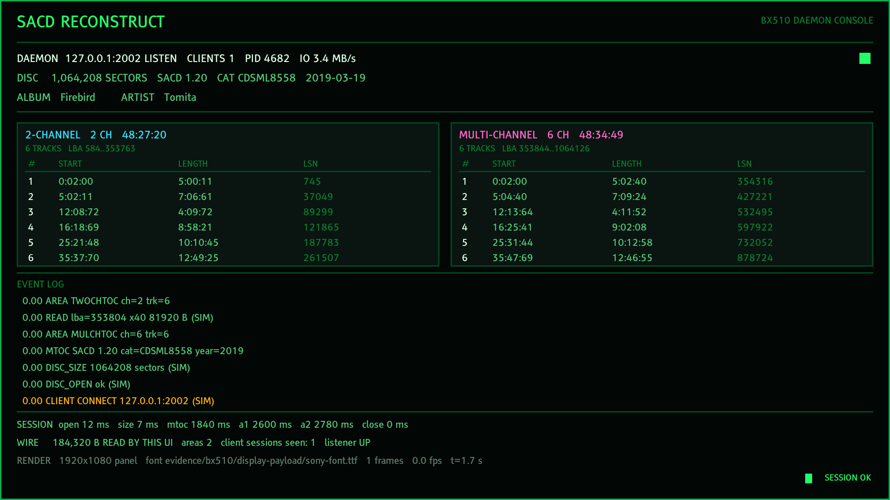
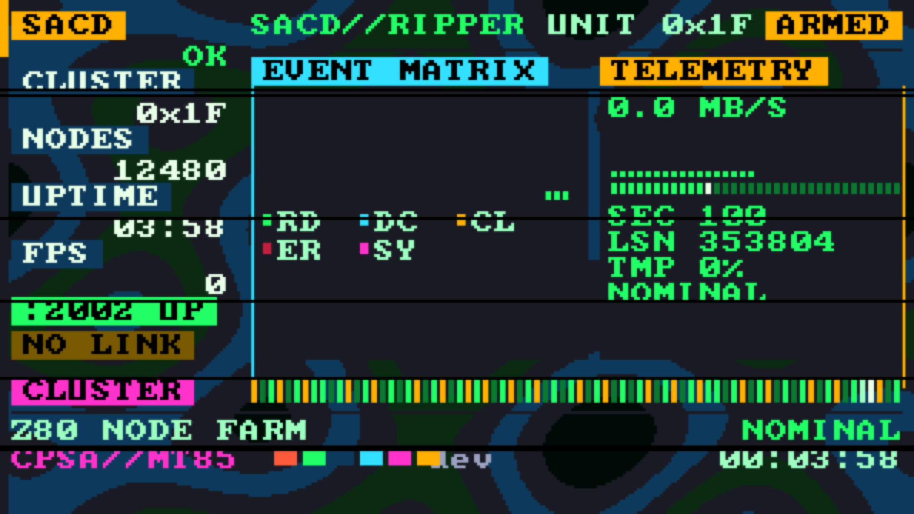

# sacd_extract_160 — reconstruction

Full source reconstruction of the closed-source ARM binary `sacd_extract_160`
(SACD-ripping daemon from the "AutoScript" USB packages for certain Sony
BD/SACD players), engineered back to byte-level parity with the original —
and now driven end to end: the reconstructed daemon serves the disc, the
same binary as a client rips playable DSF files from it, and a QEMU model of
the player runs Sony's own kernel and rootfs to prove all of it without
touching hardware.



*The daemon's console UI — this exact frame is proven to render inside
Sony's own guest OS. Below, the in-daemon HUD: the daemon painting its own
telemetry panel. [docs/GRAPHICS-GALLERY.md](docs/GRAPHICS-GALLERY.md)
embeds the rest.*



## Status (updated 2026-11-16)

- **387/390 functions instruction-identical** (normalized disassembly,
  `tools/fn_diff.py`). Three accepted residuals: the two startup stubs
  (`_start`, `call_gmon_start`) and one **deliberate divergence** —
  `recursive_mkdir` tolerates `EPERM` (the original ran as root on the
  player and never met it; a non-root reproducer does). Reason recorded at
  the patch site and in `tools/sacd_parity.sh`.
- **Literal-pool parity**: content + load-site position
  (`tools/pool_audit.py`) — this caught two real reconstruction misreads
  (`L"c"` and `__FILE__`).
- **Release candidate** `reconstruct/release/sacd_extract_160_release`,
  SHA-256 `b0848b73e17db5264e5fab54e942d8a345f21d6bd251423193fd8284013bf7`,
  built by `tools/release_build.py` (GNU GCC 4.4.1, glibc 2.9, binutils
  2.19.1 — the recovered build recipe). `tools/release_verify.sh` gates it:
  fn_diff, link interface, six-state status test 6/6, eager binding.
- **Wire behaviour byte-identical**: qemu-user rig (original vs candidate,
  same fixture disc, manifests compared — `evidence/qemu-rig/`) AND the
  full-system differential (Sony's own kernel 2.6.35 + rootfs in QEMU, raw
  TX/RX captures — `evidence/bx510-guest/differential/`).
- **Byte-identical on the real player**: on-device run — `DISC_OPEN`,
  `SIZE 1064208`, sector hashes matching the reference ISO, beyond-EOF
  refusal, clean reconnect, standby survival
  (`evidence/bx510/hw-session-2026-11-05/RESULTS.md`).
- **Level-1 synthetic cipher**: a derived disc image carries the two audio
  areas encrypted at rest; the emulator decrypts on the real CPSA ioctl
  path; 7 acceptance gates with negative controls
  (`evidence/bx510-guest/bdpdrv/decode/level1-cipher-spec.md`).
- **The rip works**: the same binary runs as the ripper client
  (`-s -c -t N`), producing playable DSF files of the fixture disc's tracks
  through the reconstructed daemon — 213,188,877 B (track 1) and
  301,154,576 B (track 2), deterministic across repeat rips, DST→DSD decode
  exercised (`evidence/bx510-guest/rip/README.md`).
- **The UI/HUD renders**: layout regression with accepted frame goldens,
  guest renders gated on non-black, guest-vs-sim per-region parity ≥ 0.85;
  screenshots in `evidence/bx510-guest/graphics/gallery/`
  ([docs/GRAPHICS-GALLERY.md](docs/GRAPHICS-GALLERY.md)).
- **One HUD, built into the daemon**: `sacd_extract_160 -S --hud=console`
  serves the rip AND renders the HUD from the daemon's own live state
  (clients, ripping progress, disc stats) — proven in the guest while a
  real client ripped ([docs/HUD.md](docs/HUD.md)). The parity build is
  untouched (`sacd-verify` passes with the same release SHA).

## The emulation rig (everything above hardware, reproducible)

Three altitudes, cheapest first — each with committed evidence:

1. **qemu-user rig** — the daemon as real ARM code, syscalls to the host,
   device/module touches interposed onto a disc image
   (`tools/rig_run.sh`, architecture in [docs/RIG-ARCHITECTURE.md](docs/RIG-ARCHITECTURE.md)).
2. **Full-system guest** — Sony's own kernel + squashfs rootfs booting in
   our `sony-bx510` QEMU machine (`emulator-kit/`); gates boot the guest,
   replay client sequences, compare wire bytes; the HDHOST synthetic
   read-only block device serves multi-GiB disc images without staging them
   in guest RAM; the `sacd-cipher` machine property arms the decrypt leg.
3. **Hardware** — the real player over USB stick + LAN (runbook:
   `evidence/bx510/PLAYER-SESSION-RUNBOOK.md`).

The rule everywhere: emulator results are predictions; the player is truth.

## Layout

- `original/` — the reference binary (SHA-256
  `0fdcefdb84ae818be7385657eaf0960053f6e4452a82f19cbe6777f9c8cddb45`)
- `reconstruct/` — the buildable reconstruction (release pipeline:
  `tools/release_build.py` → `reconstruct/release/sacd_extract_160_release`)
- `emulator-kit/` — the `sony-bx510` QEMU machine (NAND, HDHOST, UART, cipher)
- `tools/` — verification + harness (see [tools/README.md](tools/README.md)
  for the full index: parity gates, wire client, rig runners, guest shims,
  UI/HUD, hardware lane, publishing pipeline)
- `evidence/` — recorded proof, one self-contained bundle per claim, results
  docs separating **demonstrated** from **inferred**
- `docs/` — [architecture](docs/ARCHITECTURE.md) · [what's inside the
  binary](docs/DAEMON-MAP.md) · [the build/test ladder](docs/LIFECYCLE.md) ·
  [the rig](docs/RIG-ARCHITECTURE.md) · [reproduction](docs/REPRODUCE.md) ·
  [evidence guide](docs/EVIDENCE.md) · [provenance](docs/PROVENANCE.md)
- `DELTA.md` — the decoded change-set vs sacd-ripper v0.3.7 (base)
- `NOTES.md` — binary-forensics working notes
- `RESEARCH-BRIEF.md` — the toolchain-identification story

## Build

Toolchain: GNU GCC 4.4.1, glibc 2.9 + glibc-ports 2.9, binutils 2.19.1
(ARM soft-float, armv6z). The release build is driven — with its full
prerequisite list — by:

```
python3 tools/release_build.py        # prints the image path + SHA-256 + link map
sh tools/release_verify.sh            # the 5-leg verification gate
```

Application flags: `-O0 -marm -march=armv6z -D_GNU_SOURCE
-D_FILE_OFFSET_BITS=64`, link `--export-dynamic`; the embedded
`sacd_read.ko` blob links via GAS `.incbin` (the `ld -b binary` route
trips a BFD 2.19.1 internal error on this blob).

## Verify

```
python3 tools/fn_diff.py original/sacd_extract_160 reconstruct/release/sacd_extract_160_release
python3 tools/pool_audit.py original/sacd_extract_160 reconstruct/release/sacd_extract_160_release
make sacd-parity                  # the wrapper: + blob identity + regression mutants
make sacd-rig                     # original vs candidate on the same disc, manifests compared
make tests                        # 77 unit gates incl. the alteration controls
```

The alteration controls are the important ones: they assert that the
comparison tooling *detects* a deliberately altered binary, so a PASS is
meaningful.
