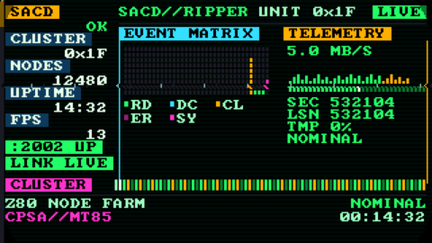

# SACD daemon reconstruction — Sony BDP-BX510 (`sacd_extract_160`)

A clean-room, function-level reconstruction of the SACD ripping daemon that ships
inside Sony's 2013 BDP-BX510 Blu-ray player (`sacd_extract_160`, SHA-256
`0fdcefdb…`), plus the tooling that proved it byte-identical on the real device.



*The reconstruction's companion HUD, running on the real player: LCARS-style
console drawn as an 8088-VGA canvas (320x180, 16 colours, integer-scaled x6), with
a blinkenlights event matrix and a colour key for verifying the panel's channel
order.*

The daemon speaks a simple binary protocol over TCP 2002 and serves raw SACD
sectors read through the player's CPSA hardware path. This repository contains:

- **`reconstruct/`** — the reconstructed C source (daemon, libs, tool).
- **`tools/`** — the verification and harness tooling (parity diff, wire client,
  pool auditor, the on-panel HUD, the emulator shims).
- **`emulator-kit/`** — a QEMU SoC model for the player (so targets can be run
  without the hardware).
- **`docs/`** — architecture, [what is inside the binary](docs/DAEMON-MAP.md),
  reproduction, evidence guide, provenance.
- **`evidence/`** — the recorded proof: gate runs, differential captures, panel
  photographs, HUD renders.

## Status

| Claim | How it is established |
|---|---|
| Reconstruction is function-level equivalent (388/390 functions) | `tools/fn_diff.py` against the original binary |
| Byte-identical wire behaviour | full-system in-guest differential, both binaries, same disc, raw captures |
| Byte-identical on the **real player** | on-device run: `OPEN`, `SIZE 1064208`, sector hashes matching the reference ISO, beyond-EOF refusal, clean reconnect |
| Large-image boundary behaviour (5 GiB) | multi-GiB battery with sentinels across the 2³² and 4 GiB boundaries |

See `docs/EVIDENCE.md` for how to read each bundle, and `docs/REPRODUCE.md` to
rerun any of it.

## Quick start

```sh
# 1. build the reconstructed daemon (ARM, era-matched toolchain)
export PATH=$PATH:/path/to/gnuarm/bin       # arm-none-linux-gnueabi-gcc
make -C reconstruct release

# 2. built against a *dump of your own player*, verify parity:
python3 tools/fn_diff.py dump/sacd_extract_160 reconstruct/release/sacd_extract_160_release

# 3. or talk to a running daemon over the wire:
python3 tools/sacd_client.py capture --host player.local --port 2002 --out out/
```

The toolchain used originally is the 2009q3 `gnuarm` cross-compiler (GCC 4.4.1,
glibc 2.9) because the target links the player's own libraries; a plain
`arm-linux-gnueabi-gcc` also works for the daemon, which is self-contained.

## What is *not* in this repository

Sony's binaries. The original daemon, the CPSA kernel module (`sacd_read.ko`) and
the firmware are **not redistributed** — `docs/PROVENANCE.md` records their
SHA-256 so you can verify against your own device. Large regenerable fixtures
(NAND images, QEMU disks) are also omitted; see `docs/REPRODUCE.md`.

## The player, briefly

The BDP-BX510 is an MT85xx SoC running Linux 2.6.35 with a monolithic `bdpdrv.ko`
(display, video, CPSA). The SACD path is: a small closed module (`sacd_read.ko`)
exposes `/dev/sacd_read`; the daemon `sacd_extract_160` maps raw 2064-byte
sectors, asks that module to decrypt them via ioctl, and serves the resulting
2048-byte logical sectors on TCP 2002.

Two facts worth knowing if you reimplement anything: the module's `compid`
parameter must not collide with the appliance's (it returns `-EBUSY` with the
message *"compid = N is used. Try another."*), and the appliance's display
scan-out is an MT85xx image-pool buffer, not the `/dev/fb0` smem.

## Licence

Our code: MIT (see `LICENSE`). Third-party assets and their licences:
`THIRD_PARTY.md`. Sony's binaries remain Sony's.
