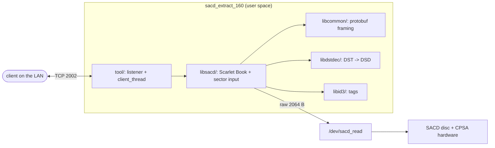
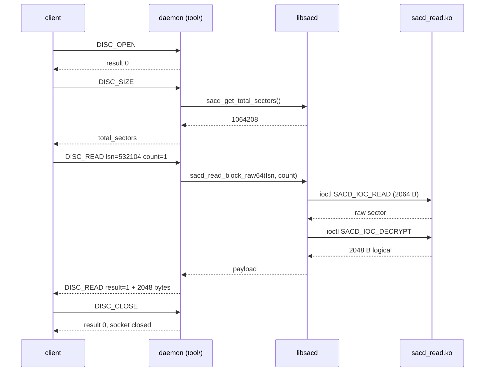
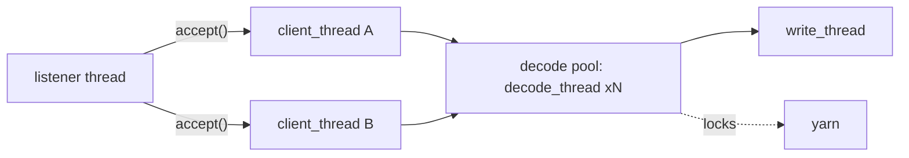
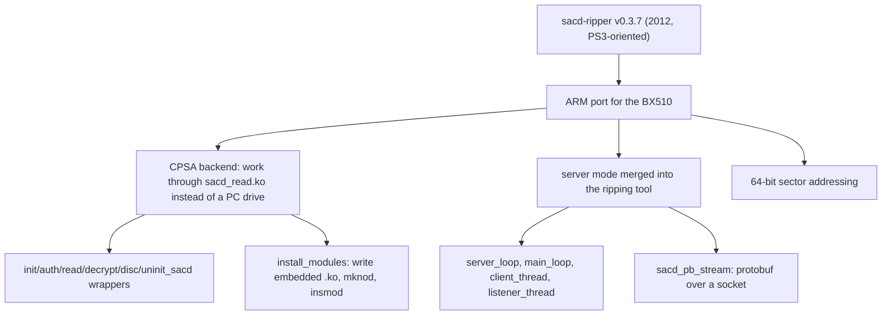

# What is inside `sacd_extract_160`

A guided tour of the binary that runs on the player: what each part does, how big it is, and why the shape looks the way it does. The numbers come from the linker map of the reconstructed build (`make sacd-daemon-map`); the prose is context a map cannot carry.

## The device, in one paragraph

The BDP-BX510 is a 2013 Sony Blu-ray player built on MediaTek's MT85xx SoC: an ARMv6 core at a few hundred MHz, 376 MB of RAM, Linux 2.6.35, and a monolithic 8 MB `bdpdrv.ko` that owns display, video decode and the SACD hardware path. Firmware `M15.R.0257` ships a single binary that matters to us, `/usr/local/bin/sacd_extract_160`, plus a small closed kernel module, `sacd_read.ko`, that it loads at runtime from its own body.

The player can already play SACDs. What it cannot do is hand you the DSD bitstream — so somebody at Sony wrote a tool that rips the disc, and then the tool leaked into the world as the community's ripping method. That tool is what this repository reconstructs.

## Why a SACD needs a daemon at all

A SACD is Scarlet Book: single-layer or dual-layer, up to 4.7 GB, carrying DSD audio in either raw form or **DST**, a lossless compression used when there is too much data for the layer. Crucially the audio area is **encrypted**, and the keys live in the disc's CPSA (Content Protection for Secure Audio). No PC drive will help you: a computer DVD drive cannot read the pit geometry correctly, and the player's own CPSA hardware is the only thing that decrypts it.

So the daemon does not decrypt anything itself. It reads *raw* 64-bit sectors and asks the player's module to decrypt them through ioctls. That single design decision explains the binary's shape: most of the code is disc structure and audio format, very little is protocol.

### 2064 and 2048 — the two numbers that define the wire

A SACD sector on the disc carries **2064** bytes: 2048 bytes of payload plus a 16-byte header. The decryption path consumes the 2064-byte raw sector and yields the 2048-byte logical sector, and it is the **2048-byte** form that travels over TCP — which is why a client asks for `sector_count` and gets exactly `count * 2048` bytes back, and why the TOC's total-sector count multiplied by 2048 equals the ISO's byte length exactly (Firebird: 1,064,208 sectors = 2,179,497,984 bytes).

## Where the code goes



## A single read, end to end



## The byte budget, and what it says

| module | objects | `.text` bytes | share | |
|---|---:|---:|---:|---|
| `libsacd/` | 15 | 67504 | 46.0% | `██████████████████······················` |
| `libdstdec/` | 9 | 28368 | 19.3% | `████████································` |
| `libcommon/` | 10 | 28176 | 19.2% | `████████································` |
| `libid3/` | 7 | 12340 | 8.4% | `███·····································` |
| `tool/` | 4 | 7744 | 5.3% | `██······································` |
| `other` | 7 | 2512 | 1.7% | `█·······································` |
| `crt` | 5 | 172 | 0.1% | `········································` |
| **total `.text`** | 57 | **146816** | 100% | |

Read it as a statement about the problem, not about our effort: **half the binary is disc structure** — Scarlet Book areas, TOC parsing, the sector reader, and three output writers — and a further quarter is DST. The network protocol is the smallest part. A reimplementation that starts with the wire format is starting from the easy end.

## The biggest translation units

| object | `.text` bytes | module | what it is |
|---|---:|---|---|
| `libsacd_scarletbook_read` | 19948 | `libsacd/` | reads and validates the disc's area/TOC structures |
| `libsacd_dsdiff` | 19416 | `libsacd/` | DSDIFF (DFF) writer — header, ID3 chunk, DST frame passthrough |
| `libdstdec_unpack_dst` | 9496 | `libdstdec/` | DST entropy decoding: the arithmetic-coded frame unpacker |
| `tool_main` | 7148 | `tool/` | options, install_modules, and the merged server mode |
| `libsacd_scarletbook_output` | 5856 | `libsacd/` | the output_format dispatch layer |
| `libcommon_pb_decode` | 5236 | `libcommon/` | protobuf decode (client requests) |
| `libcommon_socket` | 5184 | `libcommon/` | LuaSocket-derived socket helpers with timeouts |
| `libsacd_scarletbook_print` | 5168 | `libsacd/` | TOC/metadata printing (the -P style output) |
| `libdstdec_dst_fram` | 5104 | `libdstdec/` | DST frame-channel mapping |
| `libcommon_fileutils` | 4580 | `libcommon/` | file helpers used by the writers |
| `libcommon_pb_encode` | 3980 | `libcommon/` | protobuf encode (server responses) |
| `libsacd_sacd_input` | 3816 | `libsacd/` | sector input layer: raw reads -> logical sectors |
| `libid3_id3` | 3688 | `libid3/` | ID3 tag container |
| `libid3_id3_frame` | 3476 | `libid3/` | ID3 tag container |

## The source tree

| directory | files | C/asm | headers | notes |
|---|---:|---:|---:|---|
| `fsflibgcc/` | 11 | 6 | 3 | static libgcc/glibc support the original carries |
| `libcommon/` | 25 | 11 | 13 | logging, sockets, protobuf, filesystem |
| `libdstdec/` | 20 | 9 | 11 | DST decoder (Philips reference lineage) |
| `libid3/` | 11 | 7 | 2 | ID3 tag library |
| `libsacd/` | 40 | 18 | 20 | the disc model and writers |
| `release/` | 2 | 0 | 0 | linker map + release binary (build output) |
| `tool/` | 10 | 4 | 2 | daemon entry point and the CPSA wrappers |

## Threads, and one inherited quirk



The original reuses **one stack slot** for the peer address across every accepted connection, so concurrent clients can interleave into the same slot. It is not a bug we fixed — it is behaviour the reconstruction keeps, and the concurrent-session evidence exists to prove both binaries do the same thing rather than to prove either one is correct.

## The community delta — the part with no upstream source

The binary is a port of **sacd-ripper v0.3.7** (commit `de008ff`, 2012-12-29). Everything below exists only in the shipped ARM build, so it had to be recovered from the binary:



Each arrow is a place where the PS3 assumption broke. The PS3 tool had a dialog UI and a local drive; the player has neither, so the UI became a listener loop and the drive became a handful of ioctls.

## Two device facts that shaped everything downstream

1. **`compid` ownership.** `sacd_read.ko` takes a CPSA compute id as a module parameter. If the appliance already holds it, the module's init returns `-EBUSY` and prints *"compid = N is used. Try another."* — a message the stock launch line throws away, which is why a daemon can die in one second with no visible cause.

2. **The panel is not `/dev/fb0`.** The display scans out an MT85xx image-pool buffer; a paint into the fbdev smem is overwritten within about two seconds. Anything drawing on this device has to go through the vendor pool (or the retail DirectFB stack).

## How to keep this document true

```sh
make sacd-daemon-map      # regenerate the numbers from release.map
make -C reconstruct release   # if you changed the source, rebuild first
```

If a number here disagrees with the binary, this document is wrong — the map is the source of truth. The same rule governs `docs/EVIDENCE.md`: claims carry the artefact that produced them.
