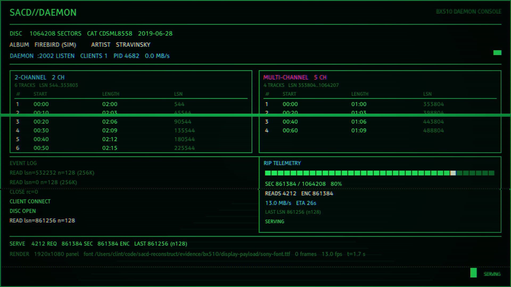
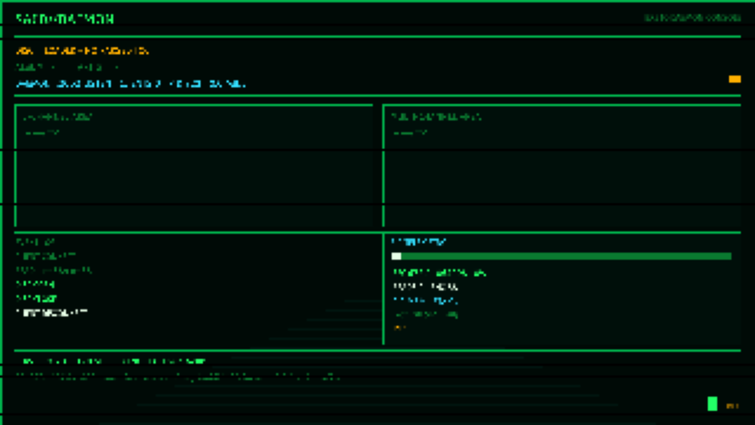
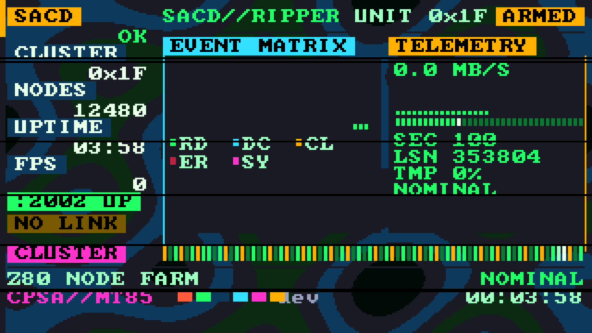
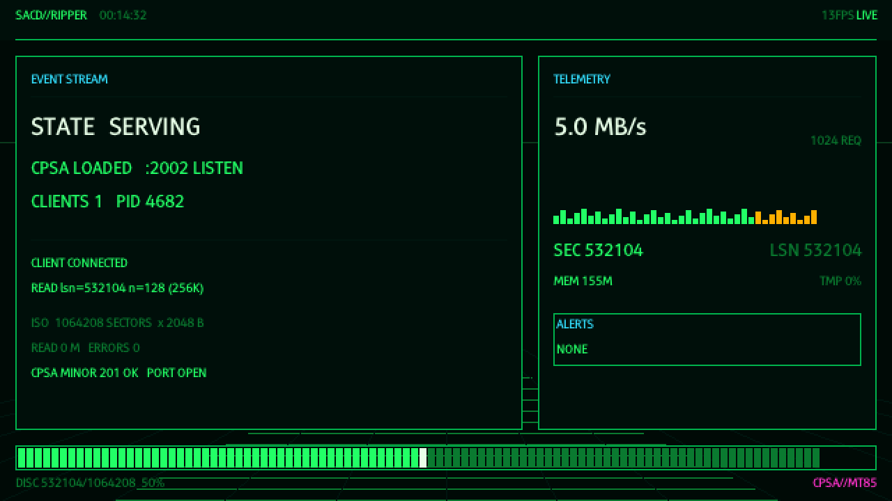
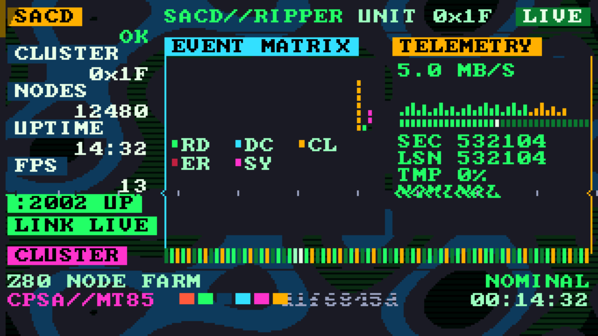
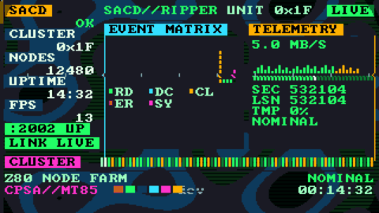
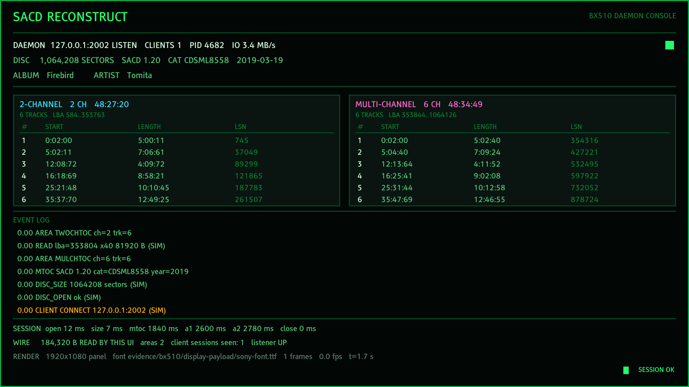
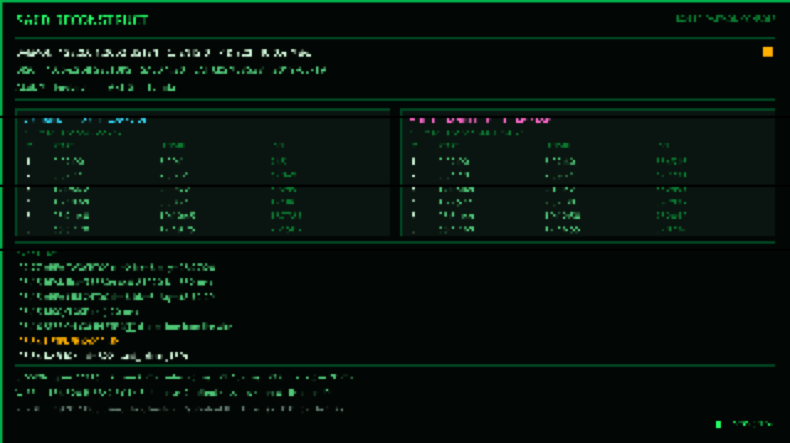
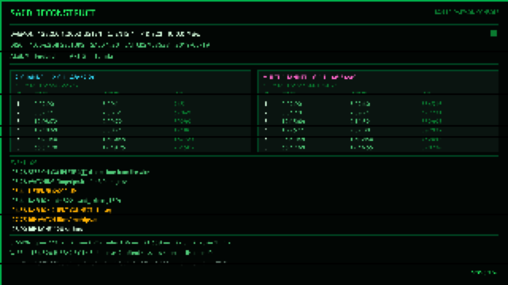

# Graphics gallery — what the reconstructed stack actually renders

Every image here is a captured or reproducible artifact, not a mock-up. The
goldens are the reference frames; the guest captures are what Sony's real
guest OS painted; the parities tie the two together. Files live in
`evidence/bx510-guest/graphics/gallery/` (same names as below).

**The daemon's UI is its HUD** — one thing: **`sacd_hud`**, the cyberpunk
telemetry console (event matrix, wireframe cube, throughput panels), built
INTO `sacd_extract_160` so it reads the daemon's own live state directly
(see [HUD.md](HUD.md) §Architecture). It is the only product UI in this
gallery.

Two other graphics programs appear below and are **not** the daemon's UI:

- **`sacd_ui`** — a *client-leg milestone artifact*: a separate-process
  console that holds a real client session and reads the TOC off port 2002.
  Kept as a regression fixture, not shipped on the stick.
- **`cyberdraw`** — a display-leg *test pattern*, not a product.

All three programs are proven to run inside Sony's real guest OS.

## The HUD (`sacd_hud`) — the daemon's UI

### The merged disc console (`HUD_SCENE=disc`)

*`hud-disc-sim.png` — the disc-console scene, full resolution. The client-leg
console's layout (title, status, two area panels with track tables, event
log) in the HUD's palette with the device fx; the right column is the live
rip telemetry. Region + palette probes: `make sacd-hud-disc-sim`.*

*`hud-disc-guest.png` — run hudisc4 (2026-11-16): the SAME scene painted BY
`sacd_extract_160 --hud=panel HUD_SCENE=disc` inside Sony's real guest OS,
dumped MID-RIP (the track tables carry the real TOC the daemon parsed; the
telemetry bar is the live rip). Pool mean luminance 13.54, gated PASS.
Captured at 320x180 over the UART, 3x upscaled.*

### The retro panel (chunky DOS look)

*`ui-hudpan2/pool-3x.png` — the panel mode of the in-daemon HUD: this frame
was painted BY `sacd_extract_160` itself (the `--hud=panel` thread inside
the daemon process), captured in the guest, pool mean luminance 50.49
PASS. One binary serves the rip and draws the panel.*

*`hud-sim.png` — the host simulator (1280x720, real Sony font), the
seconds-per-iteration layout loop.*

*`hud-guest-render.png` — the same HUD code running in the real guest
(kernel 2.6.35), decoded from the UART `FBPIX` capture. Gate: rc=0 and
non-black (mean luminance 83.84), PASS 3x on 2026-11-16.*

*`hud-anim.gif` — the wireframe cube, perspective grid, CRT sweep and the
2 Hz blink; blink period asserted by `make ui-anim`.*

| image | what it shows | provenance |
|---|---|---|
| `hud-disc-sim.png` | the merged disc console, 1920x1080, device-res text | `make sacd-hud-disc-sim` (region + palette probes gate it) |
| `hud-disc-guest.png` | the disc console painted by the daemon in the guest, mid-rip | run `hudisc4` (2026-11-16); `evidence/bx510-guest/graphics/ui-hudisc4/` |
| `ui-hudpan2/pool-3x.png` | the retro panel mode: the daemon painting its own telemetry from its live state | run `hudpan2` (2026-11-16), `--hud=panel` in the guest; pool mean luminance 50.49, gated PASS — `evidence/bx510-guest/graphics/ui-hudpan2/` |
| `hud-sim.png` | Mac SIM render, 1280x720, real Sony font + synthetic telemetry | `make sacd-hud-sim` (the layout-iteration loop, seconds per frame) |
| `hud-guest-render.png` | the HUD rendered in the real Sony guest, 640x360x3 capture decoded from the UART `FBPIX` hex line | `make sacd-hud-guest` — gate PASS 3x on 2026-11-16 (rc=0, mean luminance 83.84); green since e9dbd8b (pool-mmap render path) |
| `hud-anim.gif` | the HUD animating: rotating wireframe cube, perspective grid, CRT sweep, cursor blink | `make sacd-hud-anim`; blink period asserted 2 Hz +/-10% by `make ui-anim` |

## The client-leg console (`sacd_ui`) — milestone artifact, regression fixture (not the daemon's UI)

*`ui-sim-golden-s1.png` — the accepted golden frame, 1920x1080. Renderer,
spec and font shas are pinned in `regress/golden/manifest.json`; this is the
frame the guest is proven to reproduce per-region (>= 0.85 ink correlation).*

*`ui-guest-docshot1.png` — run docshot1 (2026-11-16): the console held its
own wire session in the guest (DISC_OPEN -> SIZE -> TOC reads -> DISC_CLOSE,
catalog `CDSML8558` decoded off port 2002) and the rip client PASSED in the
same run. Captured at 320x180 over the UART (3x upscaled here).*

*`ui-guest-c132-watch.png` — the c132 overlap experiment: `DAEMON CLIENT
CONNECT (1 live)`, `RIP WATCH file=/tmp/ripA.bin`, `RIP DONE 128 sectors` —
the console observed a second client working, live.*

| image | what it shows | provenance |
|---|---|---|
| `ui-sim-golden-s1.png` | the accepted golden frame, scene s1-full, 1920x1080: master TOC + both area TOCs + 6 tracks + ASCII disc map | accepted by explicit human `make ui-golden GOLDEN=accept`; renderer sha + spec sha + font sha recorded in `regress/golden/manifest.json` |
| `ui-guest-docshot1.png` | the SAME scene rendered INSIDE the Sony guest (QEMU, kernel 2.6.35), 320x180 capture upscaled 3x | run `ui-docshot1` (2026-11-16): the console held its own wire session (`UI-EV 0003-0012`: DISC_OPEN -> SIZE -> READ 510x10 -> READ 544x40 -> READ 353804x40 -> DISC_CLOSE), decoded `cat=CDSML8558 year=2019` from bytes read off port 2002, and the rip client PASSED in the same run (`CLIENT_PASS`). Transcript: `evidence/bx510-guest/bdpdrv/bdpdrv-rundocshot1.uart.log` |
| `ui-guest-c132-watch.png` | the console while a SECOND client rips: `* DAEMON CLIENT CONNECT (1 live)`, `RIP WATCH file=/tmp/ripA.bin`, `RIP DONE 128 sectors` | run c132 (the F-1 overlap experiment); `evidence/bx510-guest/graphics/ui-c132/shot.md` |

Guest-vs-SIM parity: per-region ink correlation >= 0.85 on the latest ui-loop
runs (`make ui-parity`); layout regression 5/5 scenes PASS with the accepted
goldens (`make ui-regress`).

## Capture-fidelity notes (read before judging image quality)

- Guest captures ride the UART transcript as one `FBPIX` hex line; the
  standard capture is 6x-downscaled (320x180) and loses 3-7 rows to console
  interleaving (zero-filled black stripes). These losses are MEASURED and
  reported per frame in every `shot.md`, never eyeballed away.
- The full-resolution ground truth for any scene is the SIM golden; the
  guest is proven to reproduce it per-region (>=0.85 ink correlation), so
  `ui-sim-golden-s1.png` is what the guest paints, row-exact.
- A `UI_SCALE=1` full-res guest dump (1920x1080 over several UART chunks)
  is possible but slow; not needed while parity gates carry the proof.

## Regeneration

    make sacd-hud-sim                 # hud-sim.png
    make sacd-hud-anim                # hud-anim.gif
    make sacd-hud-guest               # guest HUD render + gate verdict
    make bx510-ui-loop RUNID=<id>     # fresh guest UI capture -> ui-<id>/
    make ui-regress-all               # layout + animation + guest-parity suite
